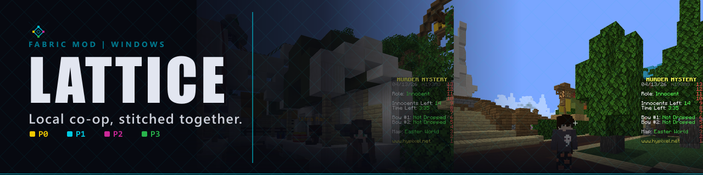
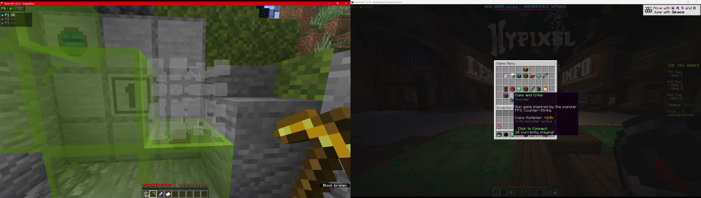
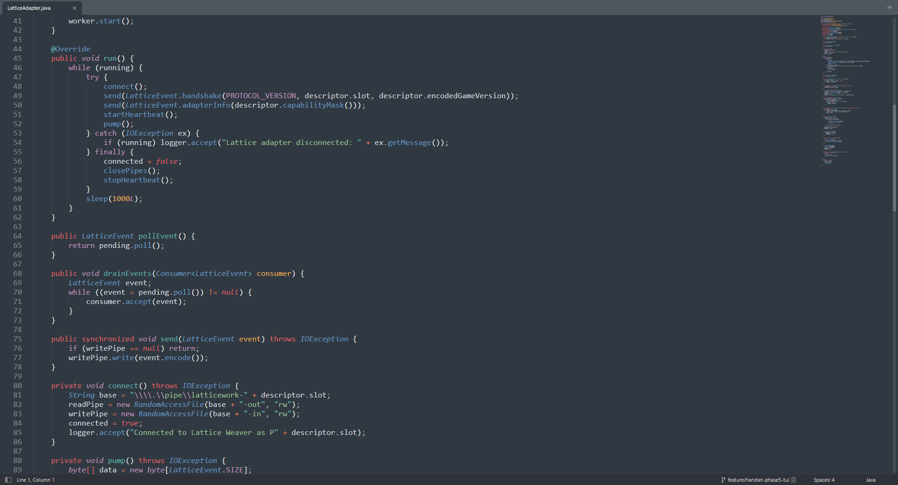
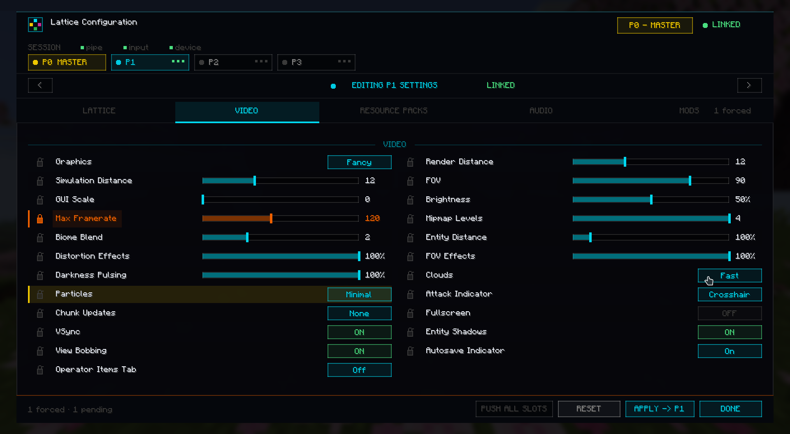
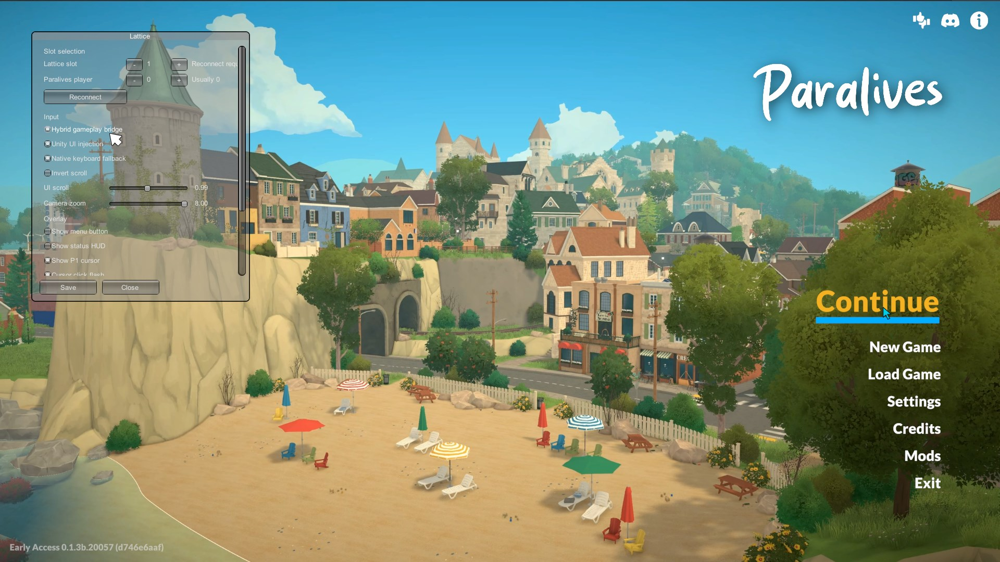
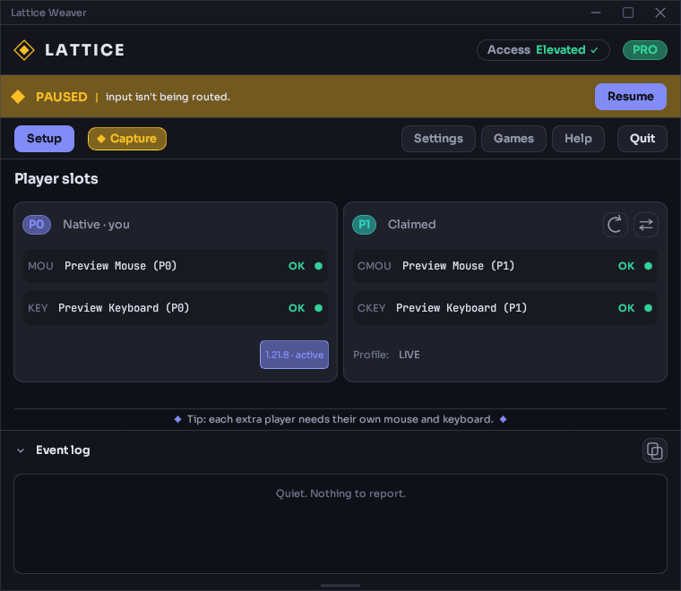

# Lattice

**Lattice splits one PC's peripherals across several players and routes each set into its own game instance.** It is local, same-screen multiplayer on a single machine, built on real per-device input routing rather than window tricks. Everyone sits at the same computer, and each player drives their own game with their **own mouse and keyboard**.

Lattice is two things at once. For players, it is the shortest path to same-PC co-op in a growing list of games, Minecraft splitscreen included. For developers, it is an input-routing subsystem and an adapter kit for bringing local co-op to a game of your own.

## What Lattice is

Lattice has three parts:

- **Lattice Weaver**, the routing subsystem. A companion app that claims each player's physical devices at the device level, binds them to a player slot, and routes that input into the right game instance. Player 0 (the host) keeps native OS control. Players 1 and up drive their own instance. Weaver runs a guided graphical setup, and also runs headless from the command line for automation.
- **Adapters**, the game-side receivers. Each adapter takes a player's routed input inside a specific game and can add in-game affordances such as a per-player HUD, a virtual cursor, and host master controls.
- **The Devkit**, the adapter kit. A manifest schema, adapter contract, and Java and C# SDK surfaces for building a new adapter. Adapters declare their capabilities and receive only the public adapter surface. Weaver keeps routing, licensing, and device-claim internals private.

GitHub hosts the public release assets (the Weaver binary, the mod jars, checksums) and this overview. Minecraft players can also get the mod from **[Modrinth](https://modrinth.com/mod/latticework)**. Lattice Weaver is available at **[bide.cx](https://bide.cx)**.

## How it works

1. **Install Lattice Weaver and run it.** It opens a guided setup.
2. **Assign devices by using them.** When Weaver asks, move the mouse or press a key on the set you want for Player 1, then Player 2, and so on. Whatever you actuate is claimed and bound to that slot. Player 0 keeps native control. Players 1 and up are routed to their own instances.
3. **Launch one game instance per player.** Weaver routes each player's claimed mouse and keyboard to their own window through the game's adapter.

## Supported games

| Game | Status | Notes |
|------|--------|-------|
| **Minecraft Java** | Stable | Fabric mod, versions `1.20` to `26.1.2`. In-game HUD, per-player virtual cursor, and Player 0 master controls for settings, resource packs, and per-slot profiles. |
| **Paralives** | Supported | BepInEx plugin. Independent per-player cursor, scroll, click, keyboard, and UI input. The game itself is in early access. |
| **The Sims 2** | Beta | Generic-window adapter. Routed per-player input. |
| **The Sims 3** | Beta | Native-proxy adapter, versions `1.67` and `1.69`. Routed per-player input. |

Lattice Weaver is required for routing in every supported game. The Minecraft adapter is free. Paralives, The Sims 2 (beta), and The Sims 3 (beta) sit behind the lifetime license. Older titles may move into the free tier over time.

## Platforms

| Platform | Status |
|----------|--------|
| **Windows** | Stable. Windows 10 and 11. |
| **macOS** | Alpha. The first macOS build of the Weaver backend. Early, and player-testers are welcome. |
| **Linux** | Planned. |

Player-testers can request access to alpha and in-progress platforms at `support@bide.cx`.

## Building adapters

The **Lattice Devkit** is for developers who want to add local co-op to a game. An adapter is the game-side half of Lattice: it receives a player's routed input and presents it to the game, and it can add per-player cursors, a HUD, and host master controls. The Devkit provides the manifest schema, sample manifests, the adapter contract, and the Java and C# SDK surfaces.

Adapters only ever see the public adapter surface. Routing, licensing, and device-claim internals stay inside Weaver, so an adapter never has to care how a device was claimed or how input reaches it. Download the Devkit from [GitHub Releases](https://github.com/bideco/lattice-weaver/releases/latest/download/Lattice-Devkit.zip). To discuss an adapter, contact `support@bide.cx`.

## Downloads

- **Lattice Weaver** (companion, required) at [bide.cx](https://bide.cx) or [GitHub Releases](https://github.com/bideco/lattice-weaver/releases).
- **Minecraft mod jars** at [Modrinth](https://modrinth.com/mod/latticework) or GitHub Releases. Pick the jar that matches your Minecraft version:

  | Minecraft version | Jar |
  |---|---|
  | 1.20 | `latticework-2.0.0+1.20.jar` |
  | 1.20.1 to 1.20.6 | `latticework-2.0.0+1.20.1-1.20.6.jar` |
  | 1.21 to 1.21.4 | `latticework-2.0.0+1.21-1.21.4.jar` |
  | 1.21.5 | `latticework-2.0.0+1.21.5.jar` |
  | 1.21.6 to 1.21.8 | `latticework-2.0.0+1.21.6-1.21.8.jar` |
  | 1.21.9 to 1.21.11 | `latticework-2.0.0+1.21.9-1.21.11.jar` |
  | 26.1 to 26.1.2 | `latticework-2.0.0+26.1-26.1.2.jar` |

- **Lattice Devkit** (the adapter SDK for building a game adapter) as `Lattice-Devkit.zip` on [GitHub Releases](https://github.com/bideco/lattice-weaver/releases/latest/download/Lattice-Devkit.zip).
- **Checksums** are published as `SHA256SUMS.txt` on each release.

The v2.0.0 release ships Fabric only. NeoForge and Forge builds are in testing. To help playtest one, email `support@bide.cx`.

## Minecraft setup

1. Install [Fabric Loader](https://fabricmc.net/use/) and [Fabric API](https://modrinth.com/mod/fabric-api). [Mod Menu](https://modrinth.com/mod/modmenu) is recommended for the in-game config screen.
2. Give each player their own instance (Prism Launcher or MultiMC make this easy) and copy the matching Lattice jar into each instance's `mods` folder.
3. Run **Lattice Weaver guided setup** to claim each player's devices.
4. Assign each instance's player slot, either through Weaver's setup or by adding the launcher JVM argument `-Dlattice.player=0` (Player 1), `-Dlattice.player=1` (Player 2), and so on.
5. Start Weaver first, then launch each Minecraft window.

For the complete walkthrough, including the in-game config reference, command-line flags, and troubleshooting, see the [Installation and Setup Guide](lattice-guide.md).

Player 0 gets a master settings screen to drive the other instances: audio and video, resource packs, and per-slot profiles, where supported.

## Paralives setup

1. Install [BepInEx](https://docs.bepinex.dev/articles/user_guide/installation/index.html) into your Paralives folder.
2. Copy the Lattice Paralives plugin into `Paralives\BepInEx\plugins\`.
3. Run Weaver guided setup, then launch Paralives. The second player gets their own on-screen cursor in their player color.

## Lattice Weaver

Weaver handles device claiming, player slots, routing, and the supported-game adapters. It is **closed-source** and distributed as a Windows binary (a macOS build is in alpha). This repository hosts the public release assets and this overview, not the Weaver source.

Lattice Weaver is not code-signed yet. On first run, Windows SmartScreen may warn that the publisher is unknown. Click **More info**, then **Run anyway**. A signed build is planned. The Minecraft mod jars are unaffected. Full details are in [CHANGELOG.md](CHANGELOG.md).

## Licensing

Lattice Weaver is **free for up to two players**, the host plus one more seat, with no time limit. A one-time **lifetime license** at **$17 USD** unlocks more player seats, additional features, and the licensed adapters. A **Supporter** tier at **$29 USD** sits above the lifetime license for people who want to back the project further. There is no trial period and no per-title purchase. Order emails come from `orders@bide.cx`.

## Notes

- One mouse and one keyboard per player. Player 0 can use the PC's main set.
- The download builds are protected. Please do not redistribute. Support is `support@bide.cx`.
